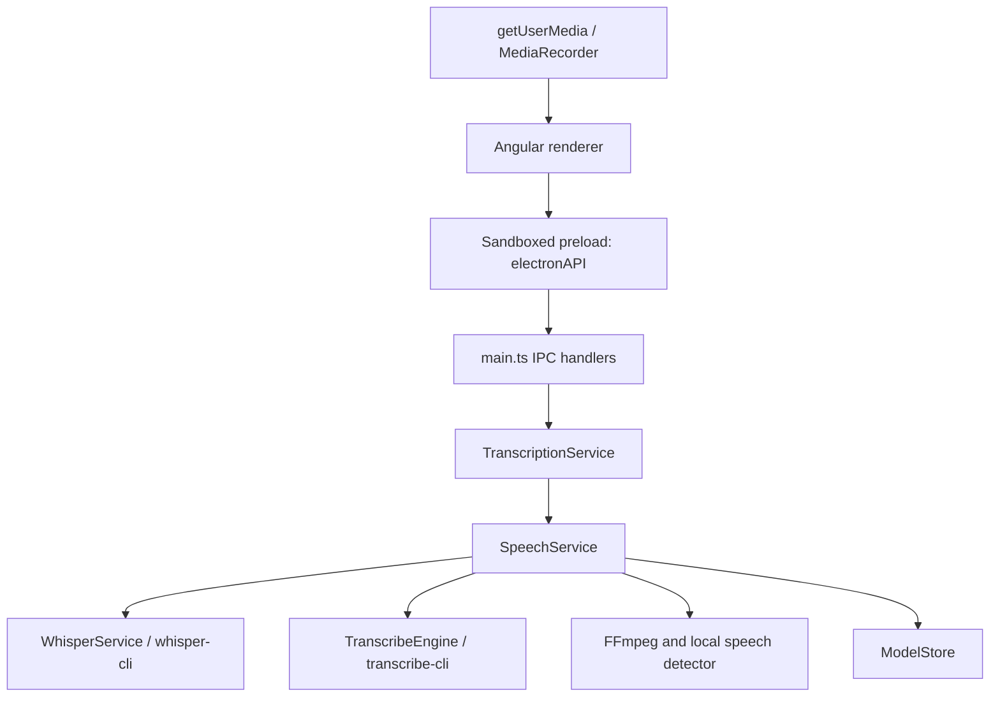

# Architecture

This describes TalaTrace 1.2.0. Use [Development](development.md) for commands and [Models](models.md) for the model catalog/measurement caveats; do not duplicate those lists here.

## Processes and engines

The renderer uses Angular 21, Candor 6 tokens/web components, Phosphor icons and locally bundled fonts. Electron 35 hosts the main process and isolated renderer. Production loads `frontend/dist/index.html`; development loads the Angular server at localhost:4200. There is no NestJS backend or production transcription HTTP server.

`electron/main.ts` creates the window, configures app-origin audio/clipboard permissions, exposes file/save dialogs, initializes the service and registers IPC. `electron/preload.ts` exposes specific operations rather than Node or raw ipcRenderer access. The renderer has nodeIntegration disabled, contextIsolation enabled and sandbox enabled. These are implemented controls, not a complete security audit of every IPC path.

## Recording and import

`AudioRecorderService` captures WebM/Opus from an audio-only media stream. The analyser reads that same stream for live frequency bars; it does not open a second microphone or play captured audio. Browser capture is limited to 30 minutes / 64 MiB.

The recording IPC accepts bounded WebM bytes from the app's main frame and writes an app-created temporary workspace. `TranscriptionService.processAudio` owns its cleanup through success/failure. Old recording workspaces are cleaned at startup after 24 hours. The renderer retains a failed recording in memory for retry; successful processing clears it. This is not a persistent audio archive.

Imported files are selected through a native dialog and limited to 500 MiB by the handler. The recording path explicitly enables token alignment, speech detection and quiet measurements. The file-import handler does not forward those analysis flags: Whisper keeps its segment-timing path, while Parakeet still exposes native token timing and may run speech detection to partition recognition. Do not infer recording/import metadata parity from the shared UI.

## Service responsibilities

| Module | Responsibility |
| --- | --- |
| `electron/services/transcription.service.ts` | One active transcription per service instance, progress/result events, decoded duration/elapsed processing, completed-session history, deletion guard |
| `electron/services/speech.service.ts` | Shared preprocessing and choice of recognition engine |
| `electron/services/whisper.service.ts` | Whisper process, FFmpeg conversion/duration, speech/quiet detection and native paths |
| `electron/services/transcribe-engine.ts` | Pinned Parakeet adapter, normalized audio, native batch execution and terminal diagnostics |
| `electron/services/parakeet-chunks.ts` | Lossless partitions across long gaps and timing translation back to the original clock |
| `electron/services/model-store.ts` | Controlled model paths, catalog presence checks, verified downloads/use, atomic publication and guarded deletion |
| `electron/services/model-catalog.ts` | Implemented IDs, repositories, revisions, hashes, sizes, languages and reference-test fields |
| `electron/services/speech-alignment.ts` / `transducer-transcript.ts` | Parse/validate model timings; preserve recognition when alignment is unusable |

Parakeet shares the Whisper/FFmpeg/VAD infrastructure; a usable Parakeet weight alone is not the whole runtime. Its availability marker requires the pinned adapter version. All recognition runs in native child processes. Model downloads require network access; recognition does not use a cloud service.

Silero estimates speech gaps; FFmpeg independently measures quiet audio. Recording output uses available speech gaps of at least 1.5 seconds, with a warning and volume-based fallback when detection fails. These are pacing context, not evidence of thinking time. Parakeet uses gaps to choose lossless partition boundaries, retaining every sample rather than deleting silence. See [Models](models.md#timing-and-pauses).

## IPC contract

The actual handlers in `main.ts` and bridge in `preload.ts` are the source of truth.

| Request channel | Result / purpose |
| --- | --- |
| `select-audio-file` | `{path, size}` or null from the file dialog |
| `transcribe-audio` | Start a file job; success envelope contains job metadata |
| `transcribe-recording` | Validate/store capture bytes and start an analyzed recording job |
| `save-transcript` | Save dialog and extension-based TXT/JSON/SRT/VTT serialization; saved path or null |
| `get-available-models` | Catalog with installed/runtime/deletion availability; discovery errors reject |
| `download-model` | Fetch controlled catalog artifact; success/message envelope |
| `delete-model` | Guarded removal of one controlled model; errors reject |
| `get-system-info` | Platform, architecture, app version, memory and CPU count; not a visible footer |
| `get-transcription-history` | Current service instance's completed-history array |

Events are `transcription-progress` (`jobId`, progress, message), `transcription-completed` (result), `transcription-error` (message) and `model-download-progress` (modelName, progress). The bridge also retains a legacy `menu-open-file` listener; the current app has no application menu producing that action.

The bridge's TypeScript declaration for `selectAudioFile` still says string/null, whereas the actual handler returns the object above. That typing mismatch is recorded in the [audit](../AUDIT_REPORT.md); documentation does not substitute a fictional implementation.

## State and storage

- The transcription component keeps separate in-memory recording/file source state. Input/transcript state does not survive closing the app.
- Completed History is in memory, capped at 50 entries. Failed jobs do not enter that completed-history list. There is no persistent history database or editor.
- Selected model is stored in localStorage as `talatrace.model`; theme uses `whisper.theme`. An unavailable saved model falls back to an installed choice. Sorting is session state.
- Weights live at `app.getPath('userData')/models`. Catalog refresh reads size/metadata; selected weights are hash-verified before recognition and downloads before publication.
- The stable internal identity is `whisper-electron-app` / `com.yourcompany.whisper-electron`. Packaged startup retains a pre-existing `Whisper Transcription` profile when present. See [Installation](installation.md#profile-and-model-storage).

## Packaged runtime layout and limits

The Windows resource list in `package.json` includes Parakeet under `transcribe-runtime/`, Whisper Vulkan under `whisper.cpp/build-vulkan/bin/`, CPU under `whisper.cpp/build/bin/Release/`, FFmpeg under `ffmpeg/bin/`, and selected model resources including Silero. `app.asar` contains compiled main/preload, renderer and production dependencies.

In development, the CPU resolver expects `whisper.cpp/build-baseline/bin/Release/`. Vulkan is preferred when its binary exists; this is presence-based selection, not an automatic retry on CPU after a GPU failure. The non-Windows resolver still expects `whisper.cpp/main`, while packaging has Windows-specific resources. [Linux #24](https://github.com/pawn002/talatrace/issues/24) tracks native Linux delivery; macOS/Linux target declarations are not validated releases.

Bundled Tiny/Base resource files are not automatically copied into a fresh packaged profile: the legacy migration checks `app.getAppPath()/models`, while packaged resources live outside app.asar. The verified clean packaged launch reports an empty library and uses explicit downloads. Do not claim automatic packaged model provisioning until code/tests establish it.
